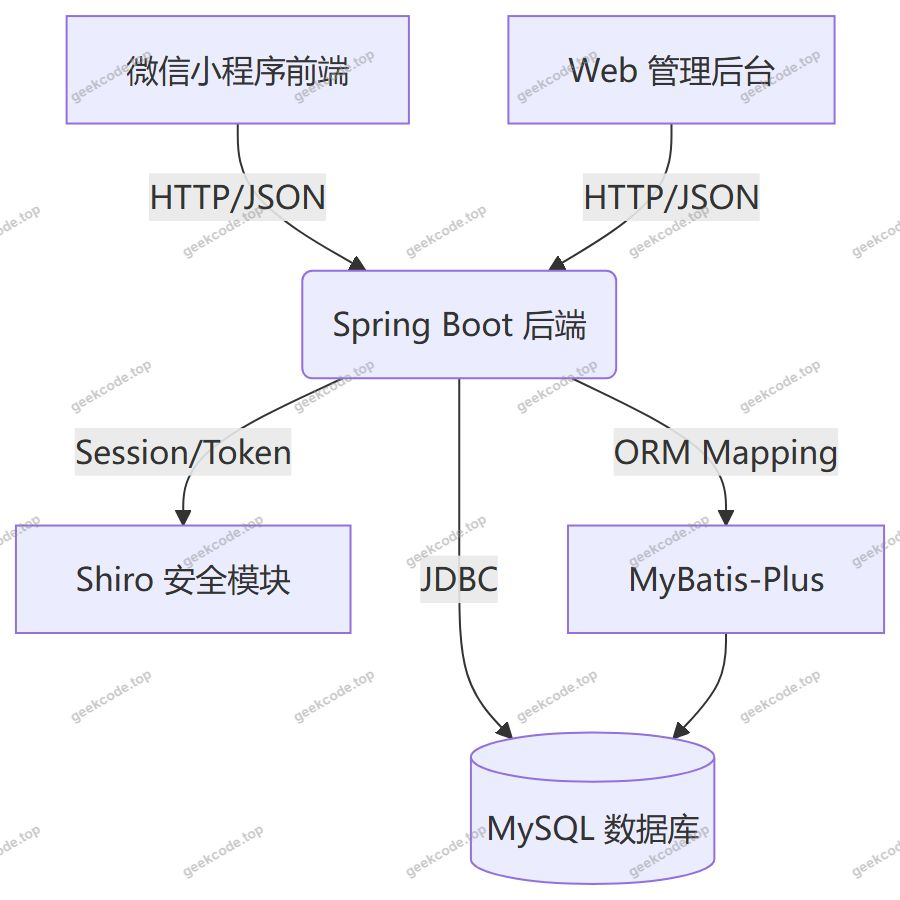
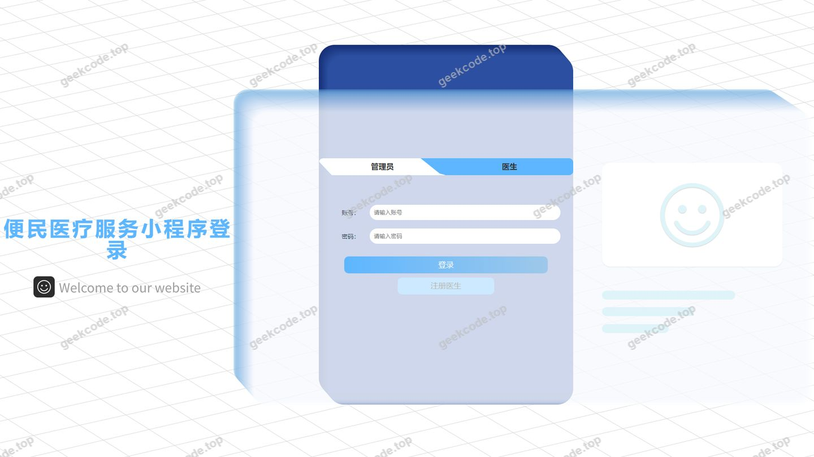

# 便民医疗服务小程序

> 🎓 **计算机毕业设计 · 便民医疗服务小程序**
>
> 本仓库只放**项目介绍 + 运行截图**（截图是站点带水印的原图，存在仓库 `images/` 里）。
>
> 👉 **完整可运行源码 / 数据库脚本 / 部署文档：[点我获取](https://geekcode.top/archives/%E4%BE%BF%E6%B0%91%E5%8C%BB%E7%96%97%E6%9C%8D%E5%8A%A1%E5%B0%8F%E7%A8%8B%E5%BA%8F?utm_source=github)**
>
> 💬 咨询微信：**ir9372**　|　🌐 更多项目：[极客代码 geekcode.top](https://geekcode.top/?utm_source=github)
>
> 📌 项目详情页：<https://geekcode.top/archives/%E4%BE%BF%E6%B0%91%E5%8C%BB%E7%96%97%E6%9C%8D%E5%8A%A1%E5%B0%8F%E7%A8%8B%E5%BA%8F?utm_source=github>

<table><td width="230" align="center"> <b>扫码加微信 ir9372</b></td><td valign="middle">📦 源码 = 项目介绍 + 全部运行截图 + 数据库 + 部署文档 👉 点上方任意截图，直接跳到 <b>极客代码 geekcode.top</b> 详情页</td></table>

---

<h1>便民医疗服务小程序</h1>
<h2>项目概述</h2>

本项目名为“便民医疗服务小程序”，旨在构建一个集预约挂号、健康资讯获取、疫苗接种管理及在线交流于一体的综合性医疗服务平台。系统采用前后端分离架构，前端包含微信小程序用户端与 Web 管理后台，后端基于 Java 技术栈开发。核心功能涵盖科室查询、医生注册与管理、挂号预约、体检报告查看、新冠疫苗及 HPV 疫苗预约、健康知识浏览及互动讨论等。该项目主要服务于普通患者群体及医疗机构管理人员，通过数字化手段优化就医流程，提升医疗资源分配效率，实现医疗服务的便捷化与智能化。

<h2>技术架构</h2>
<h3>1. 总体架构</h3>

系统采用典型的 B/S 架构结合移动端小程序模式，整体分为表现层、业务逻辑层和数据持久层。

<ul>
<li><strong>前端表现层</strong>：由微信小程序（用户端）和 Vue.js 框架搭建的 Web 管理后台组成。小程序端通过 <code>wx.request</code> 发起 HTTP 请求，Web 端通过 Axios 或 Fetch API 进行数据交互。</li>
<li><strong>后端服务层</strong>：基于 Spring Boot 框架构建 RESTful API 接口，负责处理业务逻辑、权限验证及数据转换。</li>
<li><strong>数据持久层</strong>：使用 MyBatis-Plus 作为 ORM 框架，连接 MySQL 数据库进行数据存储与检索。</li>
</ul>
<h3>2. 核心技术选型理由</h3>
<ul>
<li><strong>Spring Boot</strong>：提供快速开发的微服务基础，简化配置，内置 Tomcat 容器，便于独立部署和维护。</li>
<li><strong>MyBatis-Plus</strong>：在 MyBatis 基础上增强，提供通用的 CRUD 操作，减少样板代码，提高开发效率，同时支持复杂 SQL 定制。</li>
<li><strong>Shiro</strong>：用于安全框架，实现身份认证（Authentication）、授权（Authorization）以及会话管理，确保系统访问的安全性。</li>
<li><strong>MySQL</strong>：成熟的关系型数据库，适合存储结构化的医疗数据、用户信息及预约记录。</li>
</ul>
<h3>3. 前后端交互方式</h3>

小程序前端与 Java 后端通过标准的 HTTP/HTTPS 协议进行通信，遵循 RESTful API 设计规范。后端 Controller 层接收 JSON 格式的请求参数，处理后返回统一的 JSON 响应结果。所有接口均经过 Shiro 拦截器进行权限校验，未登录或无权限用户将被拒绝访问。

<h2>功能模块</h2>

根据提供的路由列表及代码上下文，系统功能划分为小程序用户端功能与 Web 后台管理功能两大板块。

<h3>1. 小程序用户端功能</h3>

用户通过微信小程序访问以下页面路径对应的功能模块：

<ul>
<li><strong>个人中心 (<code>/yishengCenter</code>, <code>/yonghu</code>)</strong>：</li>
<li>用户信息管理：查看和修改个人基本资料。</li>
<li>医生中心入口：若角色为医生，可进入专属管理界面。</li>
<li>我的收藏 (<code>/storeup</code>)：查看收藏的健康知识或医生信息。</li>
<li><strong>预约挂号 (<code>/guahao</code>, <code>/yuyueguahao</code>, <code>/keshi</code>)</strong>：</li>
<li>科室浏览：查看医院各科室分类及介绍。</li>
<li>医生选择：根据科室筛选医生，查看医生简介及排班。</li>
<li>挂号预约：填写就诊信息，提交挂号申请。</li>
<li><strong>健康管理 (<code>/jiankangtijian</code>, <code>/tijianyuyue</code>, <code>/tijianbaogao</code>, <code>/baogaoxinxi</code>, <code>/jiankangriji</code>)</strong>：</li>
<li>体检预约：选择体检套餐并进行时间预约。</li>
<li>报告查询：查看历史体检报告详情及基本信息。</li>
<li>健康日记：记录日常健康状况数据。</li>
<li><strong>疫苗接种 (<code>/xinguanyimiao</code>, <code>/hpvyimiao</code>, <code>/xinguanyimiaoyuyue</code>, <code>/hpvyimiaoyuyue</code>)</strong>：</li>
<li>疫苗资讯：浏览新冠疫苗及 HPV 疫苗的相关信息。</li>
<li>接种预约：在线预约特定疫苗的接种时间与地点。</li>
<li><strong>知识与交流 (<code>/yiliaozhishi</code>, <code>/discussyiliaozhishi</code>, <code>/zaixianjiaoliu</code>, <code>/zhishileixing</code>)</strong>：</li>
<li>健康知识库：按类型浏览医疗健康科普文章。</li>
<li>在线交流：参与话题讨论，与其他用户或医生进行实时沟通。</li>
<li><strong>注册与服务 (<code>/yishengRegister</code>, <code>/config</code>)</strong>：</li>
<li>医生注册：新医生入驻平台的资质审核与信息录入。</li>
<li>系统配置：部分公开的系统参数展示（如轮播图、公告）。</li>
</ul>
<h3>2. Web 后台管理功能</h3>

虽然具体后台路由未在上下文中详细列出，但基于前台路由中的管理属性（如 <code>/yisheng</code>, <code>/config</code>）及常规毕设架构，推断 Web 后台具备以下核心管理能力：

<ul>
<li><strong>用户与权限管理</strong>：</li>
<li>管理员登录与安全配置。</li>
<li>普通用户账号管理与状态控制。</li>
<li>医生账号审核与管理。</li>
<li><strong>医疗业务管理</strong>：</li>
<li><strong>科室管理</strong>：增删改查医院科室信息。</li>
<li><strong>医生管理</strong>：维护医生档案、排班信息及擅长领域。</li>
<li><strong>挂号管理</strong>：审核和处理用户的挂号预约请求。</li>
<li><strong>体检管理</strong>：配置体检项目、套餐及查看用户提交的体检报告。</li>
<li><strong>疫苗管理</strong>：发布疫苗资讯，管理 HPV 及新冠疫苗的预约名额与状态。</li>
<li><strong>内容管理系统 (CMS)</strong>：</li>
<li><strong>健康知识管理</strong>：发布、编辑、删除科普文章，设置知识分类。</li>
<li><strong>评论与交流管理</strong>：审核用户评论，管理在线交流区的帖子。</li>
<li><strong>系统配置</strong>：设置首页轮播图、公告栏及其他全局参数。</li>
</ul>
<h2>用户角色与权限</h2>

系统主要涉及两类用户角色：普通用户（患者）、医生，以及超级管理员（后台操作人员）。

<h3>1. 普通用户（患者）</h3>
<ul>
<li><strong>访问终端</strong>：微信小程序。</li>
<li><strong>权限范围</strong>：</li>
<li><strong>浏览</strong>：查看所有公开的科室、医生、健康知识、疫苗资讯。</li>
<li><strong>操作</strong>：注册/登录账号；进行挂号预约、体检预约、疫苗接种预约；撰写健康日记；收藏感兴趣的内容；参与在线交流与评论。</li>
<li><strong>查询</strong>：查看个人的预约记录、体检报告、收藏列表及个人基本信息。</li>
<li><strong>限制</strong>：无法进入医生中心，无法发布官方医疗资讯，无法管理其他用户数据。</li>
</ul>
<h3>2. 医生</h3>
<ul>
<li><strong>访问终端</strong>：微信小程序（通过 <code>/yishengCenter</code> 入口）。</li>
<li><strong>权限范围</strong>：</li>
<li><strong>入驻</strong>：通过 <code>/yishengRegister</code> 提交资质信息进行注册，等待后台审核。</li>
<li><strong>执业管理</strong>：查看与自己相关的挂号预约信息；更新个人简介、擅长领域及出诊时间。</li>
<li><strong>互动</strong>：回复患者的在线咨询或评论。</li>
<li><strong>限制</strong>：仅能管理自己的执业数据，无权查看其他医生的隐私数据或系统全局配置。</li>
</ul>
<h3>3. 管理员</h3>
<ul>
<li><strong>访问终端</strong>：Web 后台管理系统。</li>
<li><strong>权限范围</strong>：</li>
<li><strong>全量数据管理</strong>：对科室、医生、用户、挂号记录、体检报告、疫苗预约数据进行增删改查。</li>
<li><strong>内容审核</strong>：发布和管理健康知识文章，审核用户发布的评论和交流内容。</li>
<li><strong>系统配置</strong>：管理前端展示的配置项（如 Banner、公告），维护系统基础参数。</li>
<li><strong>账号管理</strong>：重置用户密码，禁用违规账号，审核医生注册申请。</li>
</ul>
<h2>项目特色与创新点</h2>
<ol>
<li><strong>全流程闭环医疗服务</strong>：项目不仅仅提供单一的信息展示，而是打通了从“信息查询 -&gt; 在线预约 -&gt; 线下就诊/接种 -&gt; 报告反馈 -&gt; 健康记录”的完整服务链条，特别是将体检报告查询与健康日记结合，实现了数据的连续性。</li>
<li><strong>专项疫苗预约模块</strong>：针对公共卫生热点，专门设计了新冠疫苗与 HPV 疫苗的独立预约与信息展示模块，体现了系统在应对突发公共卫生事件及女性健康关怀方面的针对性设计。</li>
<li><strong>医患双向互动机制</strong>：通过 <code>/zaixianjiaoliu</code> 和 <code>/discussyiliaozhishi</code> 模块，构建了轻量级的医患沟通平台，打破了传统医疗系统中信息单向传递的壁垒，增强了用户的粘性与信任感。</li>
<li><strong>多角色协同架构</strong>：在同一套后端体系下，清晰隔离了患者、医生和管理员三种角色的视图与权限，利用 Shiro 实现了细粒度的访问控制，保障了医疗数据的安全性与合规性。</li>
</ol>
<h2>部署环境</h2>

为确保项目正常运行，需准备以下软硬件环境：

<ol>
<li><strong>操作系统</strong>：Windows 10/11, macOS 或 Linux (CentOS/Ubuntu)。</li>
<li><strong>Java 运行环境</strong>：JDK 1.8 或更高版本（推荐 JDK 8 LTS，以兼容 Spring Boot 旧版本依赖）。</li>
<li><strong>数据库</strong>：MySQL 5.7 或 MySQL 8.0+。需导入项目初始化的 SQL 脚本以创建表结构和基础数据。</li>
<li><strong>构建工具</strong>：Maven 3.6+。用于管理 Java 项目的依赖包（如 spring-boot-starter-web, mybatis-plus, shiro-spring 等）。</li>
<li><strong>前端开发环境</strong>：</li>
</ol>
<ul>
<li>Node.js v14+ 及 npm/yarn（用于编译 Web 后台 Vue 代码，如有需要）。</li>
<li>微信开发者工具（最新稳定版）：用于调试和预览微信小程序前端代码。</li>
</ul>
<ol start="6">
<li><strong>服务器组件</strong>：内置 Tomcat（随 Spring Boot 启动）或外部 Nginx/Tomcat 集群（生产环境建议）。</li>
</ol>
<h2>五、技术特性</h2>
<ul>
<li>前后端集成部署，前端资源打包至后端 static 目录</li>
<li>使用 MyBatis-Plus 简化数据访问层开发</li>
<li>集成 Shiro 权限框架实现角色权限控制</li>
</ul>
<h2>六、功能模块截图</h2>
<h3>后台管理端</h3>
<h4>后台-登录页</h4>

---

## 获取完整源码

| 项目 | 说明 |
| --- | --- |
| 项目名 | 便民医疗服务小程序 |
| 运行截图 | 本文 2 张（站点带水印原图，仓库 `images/` 目录） |
| 完整源码 | [https://geekcode.top/archives/%E4%BE%BF%E6%B0%91%E5%8C%BB%E7%96%97%E6%9C%8D%E5%8A%A1%E5%B0%8F%E7%A8%8B%E5%BA%8F?utm_source=github](https://geekcode.top/archives/%E4%BE%BF%E6%B0%91%E5%8C%BB%E7%96%97%E6%9C%8D%E5%8A%A1%E5%B0%8F%E7%A8%8B%E5%BA%8F?utm_source=github) |
| 咨询微信 | **ir9372**（备注：jingpin-yuanma） |
| 更多项目 | [极客代码 geekcode.top](https://geekcode.top/?utm_source=github) |

> 需要源码、部署、改配置、跑不起来等问题，加微信 ir9372 沟通，说明项目名即可。
